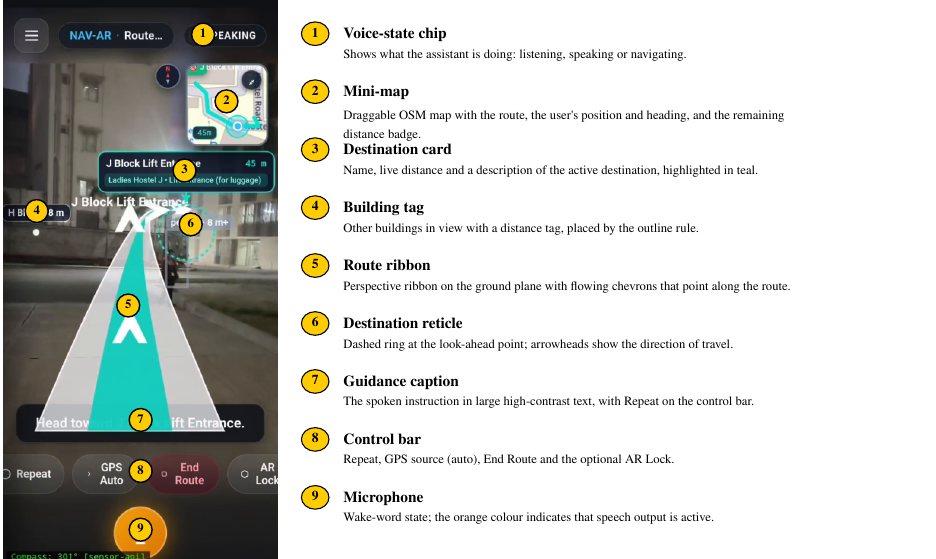
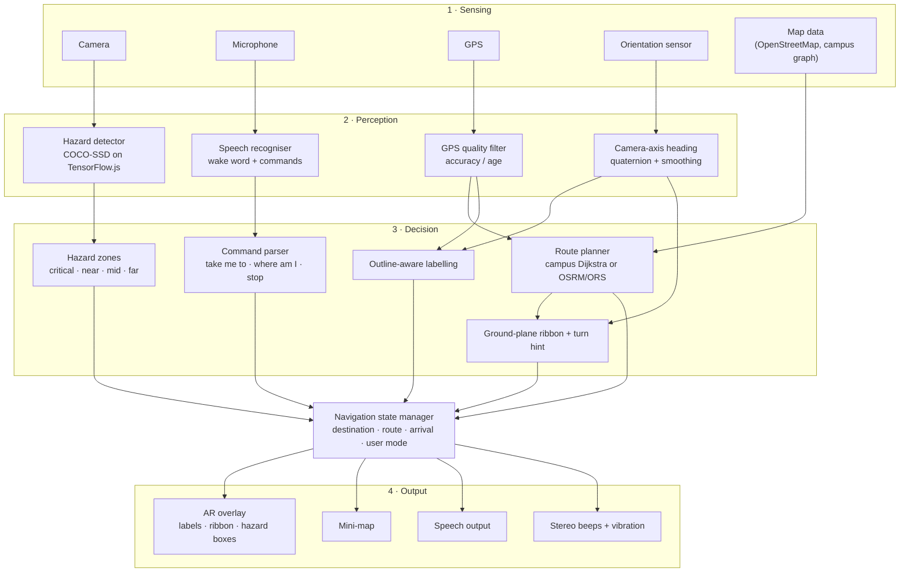
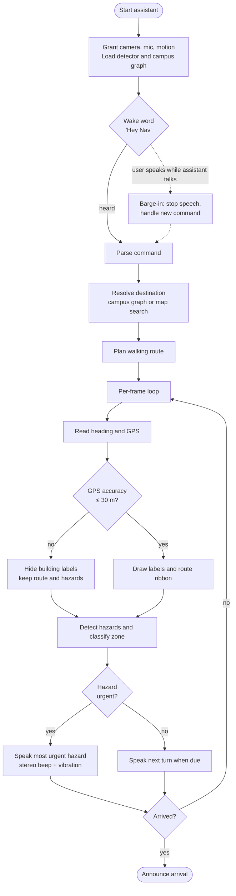

<div align="center">

# NAV-AR

### A browser-based Augmented Reality and voice navigation assistant for blind and low-vision users

Runs in a phone browser. Nothing to install, no special hardware.

`Location-based AR` · `Voice assistant with barge-in` · `On-device obstacle detection` · `Campus routing` · `Installable PWA`

</div>

---

## 1. Overview

Blind and low-vision (BLV) pedestrians need guidance that is hands-free, spoken and robust to the errors of consumer sensors. Most assistive navigation either relies on installed infrastructure (beacons, tactile tags) or treats a building as a single map point.

**NAV-AR** is a progressive web app that combines GPS routing, a compass-aligned AR overlay, on-device hazard detection and a voice assistant. One engine serves two kinds of user:

| | Blind users | Low-vision users |
|---|---|---|
| Spoken guidance and answers | ✅ | ✅ |
| Stereo-panned warning tones (left/right) | ✅ | ✅ |
| Vibration patterns for hazards | ✅ | ✅ |
| Large high-contrast AR route ribbon and turn arrow | – | ✅ |
| Building labels with distance tags | – | ✅ |
| Colour-coded hazard outlines | – | ✅ |
| Mini-map | – | ✅ |

<p align="center">
  <br>
  <em>A live NAV-AR screen: route ribbon, building label, hazard outline, guidance caption and voice control.</em>
</p>

---

## 2. Key ideas

1. **Camera-axis heading.** The viewing direction is taken from the direction the rear camera actually points, derived from the orientation quaternion, not from the device's yaw. This stays correct whether the phone is held upright or flat.
2. **Outline-aware building labels.** A building is labelled by its surveyed footprint instead of one point. The label sits at screen centre whenever the camera points anywhere between the building's two visible edges. This tolerates GPS and compass error.
3. **Ground-plane route ribbon.** The route is drawn on the floor with a pinhole camera model, so it has real perspective and stays visible even when the route is off to the side or behind the user (it is pinned to the screen edge with a turn hint).
4. **Hazard prioritisation.** Detected objects are grouped into distance zones. Only the most urgent hazard is spoken, so the user is not flooded with announcements.
5. **Voice with barge-in.** The user can interrupt the assistant mid-sentence, and can change destination mid-route.
6. **Error-tolerant by design.** Labels are suppressed when GPS accuracy is poor, calibration only uses good fixes, and stale sensor readings are discarded.

---

## 3. System architecture



### Navigation session flow



---

## 4. How it works

### 4.1 Which AR is used

NAV-AR uses **location-based (sensor-driven) AR**: virtual content is placed in the camera view from where the phone is (GPS) and where it points (orientation sensor). It does not rely on image recognition or on plane tracking, so it works in an ordinary mobile browser on both Android and iOS.

| AR element | Registered to | Technique |
|---|---|---|
| Building label | GPS position, heading, building footprint | Bearing interval of the footprint, mapped across a 60° field of view |
| Route ribbon | Ground under the user, route geometry | Pinhole ground-plane projection |
| Turn hint | Route geometry 8 m ahead | Relative bearing of the look-ahead point |
| Hazard outline | Detected object in the camera image | Bounding box, colour-coded by zone |
| Mini-map | GPS position | Leaflet map with route and position |
| AR Lock *(optional)* | Detected ground surface | WebXR hit-test (supported browsers only) |

### 4.2 Heading from the camera axis

The orientation sensor returns a quaternion `(x, y, z, w)`. The direction the **rear camera** looks along is

```
c_E = −2(xz + wy)        c_N = −2(yz − wx)
heading θ = atan2(c_E, c_N)
```

When the phone is held nearly flat, the camera axis points at the ground and is unreliable, so the heading is taken from the top edge of the phone instead. A circular exponential average (α = 0.25) smooths the result, and readings older than 3 s are discarded. Sources are tried in order: absolute orientation sensor, `deviceorientationabsolute`, `deviceorientation`, iOS `webkitCompassHeading`, and finally GPS course.

### 4.3 Outline-aware labelling

For a building with footprint vertices `q_i`, NAV-AR computes the bearing interval `[β_lo, β_hi]` that the footprint covers as seen from the user. The relative angle is

```
rel = 0                         if the heading lies inside the interval
rel = angle to nearest edge     otherwise
x   = w/2 + (rel / (F/2)) · (w/2)          F = 60°
```

Labels are shown within 60 m (120 m for the destination), and suppressed if GPS accuracy is worse than 30 m. In simulation (3 000 trials per accuracy level) this reduces label error at 10 m GPS accuracy from **7.45°** with a single anchor point to **0.78°** with the outline.

### 4.4 Ground-plane route ribbon

With focal length `f = (w/2)/tan(F/2)` and camera height `h_c = 1.4 m`, a point at ground distance `d` projects to a screen row `y = y_h + f·h_c/d`. The ribbon width is `f·W/d` with `W = 0.6 m`. When the route is outside the field of view, the ribbon is pinned to the screen edge and a "Turn left / right / around" hint is shown.

### 4.5 Hazard detection

COCO-SSD (`lite_mobilenet_v2`) runs on-device with TensorFlow.js. Distance is inferred from the ratio of the detected box height to the frame height:

| Zone | Box-height ratio | Approx. distance | Response |
|---|---|---|---|
| Critical | ≥ 0.55 | 1.5 m | Spoken warning with lateral guidance, strong vibration, stereo beep |
| Near | ≥ 0.32 | 2.5 m | Spoken warning, vibration |
| Mid | ≥ 0.16 | 4.5 m | Spoken only if approaching |
| Far | below 0.16 | 8 m | Silent |

An object counts as **approaching** when its box grows by at least 12 % over at least 0.5 s. A vehicle count over the last five detections gives a **traffic level** (LOW / MEDIUM / HIGH). A rule-based scene describer answers "what is in front of me?".

### 4.6 Voice interaction

* **Wake words:** "Hey Nav", "Hi Nav", "OK Nav", or "Nav".
* **Commands:** *take me to …*, *where is …*, *where am I*, *repeat*, *stop*, *help*, *what is in front of me*, *is there any obstacle*, *how is the traffic*.
* **Barge-in:** speaking a command while the assistant is talking stops its speech and handles the new command. The assistant's own words are filtered out as echo.
* **Place names:** spoken variants are normalised (for example "jay block" becomes *J Block*).
* **Optional AI assistant:** an open-ended question can be sent to a language model (`gpt-4o-mini`) using the user's own API key, entered in Settings. Everything else works without a key.

### 4.7 Routing

| Situation | Method |
|---|---|
| Inside the campus area (about 350 m of the campus centre) | Dijkstra on the surveyed campus graph (15 nodes, 17 edges) |
| Elsewhere | Walking route from OSRM, OpenRouteService or Google Directions (selectable in Settings) |
| Place discovery | Overpass and Nominatim (OpenStreetMap), cached for 24 h |

Once a route exists, progress is computed from the live GPS position against the route polyline, with arrival judged by proximity scaled to the reported GPS accuracy.

---

## 5. Features at a glance

- Hands-free operation with a wake word
- Spoken turn-by-turn guidance and arrival announcement
- Building labels with distance tags and a destination highlight
- Perspective route ribbon and large turn hint
- Real-time hazard warnings with left/right guidance
- Traffic level estimate
- Scene description and "read the situation" questions
- Mini-map that can be expanded
- Compass **Align** and **Log** tools for field calibration
- Works offline after first load (service worker cache)
- Installable on the home screen as a PWA
- Optional experimental WebXR AR Lock

---

## 6. Project structure

```
NAV-AR/
├── index.html              App shell and UI
├── style.css               Styling
├── manifest.json           PWA manifest
├── service-worker.js       Offline cache
├── js/
│   ├── app.js              Main controller and navigation state
│   ├── ar.js               AR overlay: labels, ribbon, hazard outlines
│   ├── hazards.js          COCO-SSD detection, zones, traffic
│   ├── voice.js            Wake word, commands, speech, barge-in
│   ├── gps-nav.js          GPS tracking and route progress
│   ├── route-provider.js   OSRM / ORS / Google routing
│   ├── map-discovery.js    Overpass and Nominatim place discovery
│   ├── mini-map.js         Leaflet mini-map
│   ├── scene.js            Rule-based scene description
│   ├── ai-assistant.js     Optional language-model assistant
│   ├── venue-graph.js      Graph and Dijkstra
│   ├── webxr-ar.js         Optional WebXR AR Lock
│   ├── localization.js     Landmark colour-descriptor hint
│   └── venues/             Venue data, campus graph and building footprints
├── map.osm, map-hostels.osm    Map data used for labels and footprints
├── dataset/                Reference photos used for indoor landmark hints
├── scripts/                Utility scripts
├── screenshots/            Interface screenshots
└── test/                   Unit and end-to-end tests
```

---

## 7. Run it

The camera, microphone and motion sensors need **HTTPS** (or `localhost`).

```bash
git clone https://github.com/Yojasree1905/NAV-AR.git
cd NAV-AR
python3 -m http.server 8443
```

* On a computer: open `http://localhost:8443`.
* On a phone: serve over HTTPS (for example GitHub Pages or a tunnel such as ngrok) and open the link in Chrome (Android) or Safari (iOS).
* Tap **Start assistant**, allow camera, microphone and motion access, then say *"Hey Nav, take me to H Block"* or choose a place from the destination list.
* To keep it like an app, use the browser's **Add to Home Screen**.

### Optional settings (sidebar)

| Setting | Purpose |
|---|---|
| Routing provider | OSRM (default, no setup), OpenRouteService or Google (needs your key) |
| AI assistant key | Enables open-ended spoken questions |
| Compass **Align** / **Log** | Field calibration and measurement of heading error |
| Test Spoken Guidance | Check the voice output on the device |

---

## 8. Testing

```bash
node test/compass-math-tests.js     # heading maths vs. the W3C orientation definition
node test/footprint-tests.js        # outline-aware label geometry
node test/path-tests.js             # ground-plane ribbon projection
node test/voice-command-tests.js    # command parsing and place-name normalisation
node test/detection-tests.js        # hazard zones and approach detection
node test/map-data-tests.js         # map and venue data checks
```

End-to-end browser tests (`test/e2e-*.js`) drive the app with simulated sensors and cover calibration, compass and location, footprints, hazard loading and voice-driven routing. The unit suites above report 208 passing checks and the end-to-end suites add 79 more (287 in total).

---

## 9. Results summary

Figures come from simulation and desktop benchmarks plus one recorded field session.

| Measure | Result |
|---|---|
| Camera-axis heading error across simulated phone poses | 0° (device-yaw baseline: 6.8° mean, 11.4° max for an upright phone) |
| Label angular error at 10 m GPS accuracy | 0.78° (outline) vs 7.45° (single anchor) |
| Labels within 10° of the true bearing at 20 m accuracy | 88 % (outline) vs 48 % (single anchor) |
| Per-frame compute for ribbon and building labels | about 0.44 ms (desktop) |
| Recorded guided session | 6.9 minutes across four consecutive voice-selected destinations |

---

## 10. Limitations and scope

* Label and ribbon accuracy depend on phone GPS and compass quality, so labels are hidden when GPS accuracy is worse than 30 m.
* Distance to a hazard is estimated from the apparent size of a detected object, not measured.
* The detector recognises the 80 COCO classes. Doors are not detected visually, and stair detection is only a rough heuristic.
* The campus graph covers one campus. Outside it, routes come from public routing services and depend on their map coverage.
* Speech recognition quality depends on the browser and needs an internet connection in most browsers.
* The optional WebXR AR Lock has not been validated on hardware and works only in supported browsers.
* No formal user study with blind or low-vision participants has been carried out yet.

## 11. Future work

- Evaluation with BLV participants
- Spatial (3D) audio cues for direction
- Indoor positioning for multi-floor buildings
- Emergency SOS with live-location sharing to a caregiver
- Personalised verbosity and guidance preferences
- A fuller offline mode with locally cached routing

---

## 12. Team

**VIT Vellore**

| Name | Register no. | Email |
|---|---|---|
| Vankireddi S Yojasree | 23MID0124 | vankireddi.s2023@vitstudent.ac.in |
| Videesha Cattamanchi | 23MID0125 | cattamanchi.videesha2023@vitstudent.ac.in |

## 13. Acknowledgements

OpenStreetMap contributors (map data), TensorFlow.js and COCO-SSD (object detection), Leaflet (maps), OSRM and OpenRouteService (routing).
